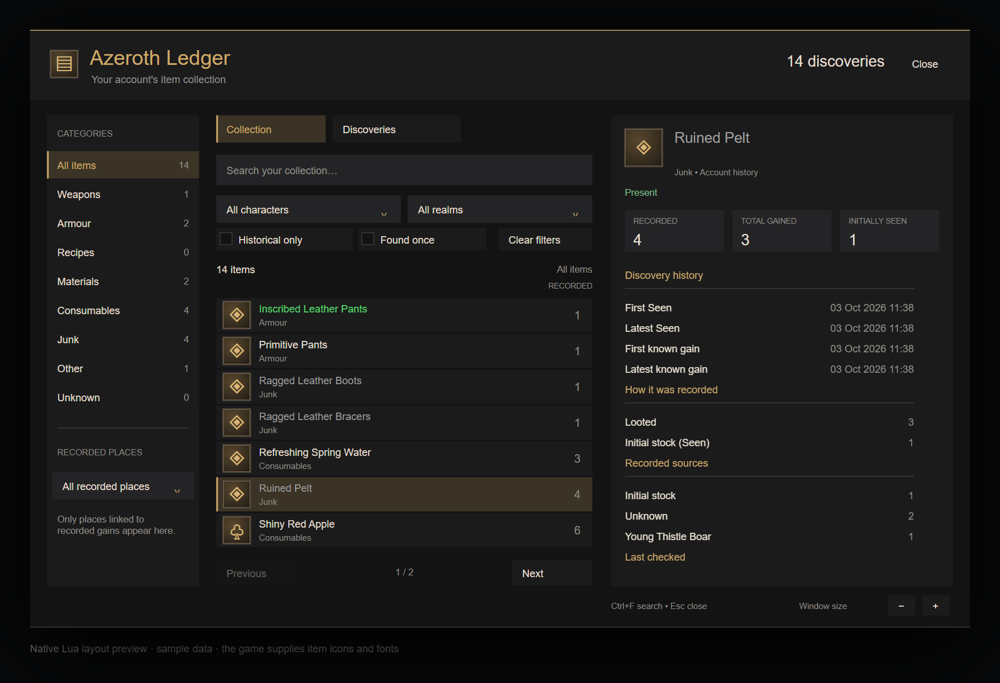

# Collection book redesign, 0.7.2

The book uses a charcoal surface, restrained gold accents, item icons and rarity colors. A counted category sidebar leads into search, named scope menus, seven item rows and a persistent detail pane. Recorded quantities stay beside each item; the detail pane separates Recorded, Total gained and Initially Seen before showing scrollable history, sources, ownership checks and full links.

This preview renders the production Lua frame tree with sample records through the native-frame test port. Browser fonts and substitute icon glyphs approximate the layout; it is not a WoW screenshot. The client supplies its own fonts, item art and scroll bar.

## Feedback improvements, 0.7.2

Icons have always come from the client. A failing client-port replay reproduced the missing icon when full item metadata was uncached. The projection now reads `C_Item.GetItemIconByID` independently, rejects empty/zero textures, requests missing item data once per item/session, and refreshes on the client's item-data events. The installed client's API export documents these APIs; actual icon rendering remains a native-client check.

Active and backup saved records contain multiple links whose item payload is identical, or differs only in viewer level/spec fields. The default detail view groups those links while preserving enchants, gems and intrinsic bonuses. Show all recorded links exposes every original full link; the saved records are unchanged.

Shaded section headers, larger titles, gold markers and spacing separate history, methods, sources, ownership and link sections. Character/Account buttons scope the entire detail projection consistently. A character or realm filter selects its own detail totals by default; without one, Account is the default and Character selects the current character. Scoped list quantities show checked units from the latest selected storage check. A + marks older or unchecked storage.

Account Recorded remains lifetime initially-seen stock plus confirmed outside gains. Character/Realm shows Checked units, Total gained and First check as separate facts. Checked units use only the latest selected check timestamp; older bank/alt observations remain dated in Last checked and make the aggregate incomplete (+). Confirmed gains are scoped and net of refunds. First check is the quantity in the first retained positive observation, and can include a gain, so it is never added to confirmed gains. Scoped method/source sections report confirmed gains; account mode retains independent initial/unknown buckets. No saved facts are repaired or inferred.

Failing-then-passing public query tests cover ten initial units on Ben versus four hundred plus two later gains on Ada, distinct scope dates/evidence, zero browsing writes, and collapsing viewer links while retaining an enchanted version. UI replay checks character/account toggling and access to all preserved links. Review caught double-counting when a new character first acquired an account-known item. Scoped first-check and gain facts now remain separate; replay covers both timely and delayed receipts, plus an older bank observation that must not be added to a newer bag check. Full local checks pass; CI and installation evidence for 0.7.2 follow once verified.

## Automated evidence

Lua 5.1 syntax, all twelve behavior specs in independent runtimes, StyLua 2.5.2, LuaLS 3.19.1, package/load order and three Python installer tests pass locally on 2026-10-03. [Full verify passes](https://github.com/ernestasgr/azeroth-ledger/actions/runs/37113451669) for code commit `e59750c`, including Luacheck 1.2.0-1, which runs only in CI on this workstation.

The public UI replay covers search, category counts, named scope menus, mouse and keyboard paging, menu selection and dismissal, empty/loading states, full item details, small-screen fitting and immediate scale changes. Selecting a new item resets its detail scroll; refreshing the same item preserves it. Tab starts at browsing controls, and Clear filters updates both checkboxes. Query and companion replays verify that browsing makes no saved-data writes and retains conservative ownership and independent method/source facts.

Final review found that short menus painted beyond their bounds and mouse paging retained a hidden keyboard selection. Both are fixed: the background follows the menu height, and mouse/page-key navigation selects a visible choice. A failing-then-passing interaction replay covers short menus and accounts with ten additional characters. CI also identified two shadowed local names; the detail title now uses a distinct name.

## Intended-client evidence

Native app control is unavailable in this environment. In-client appearance, keyboard behavior and the genuine AzerothLedgerCollection WoWUnit group remain pending. Record build, locale, test result and Lua errors when exercising 0.7.2. Use `/reload` then `/al`, inspect short and long item histories, open scope/place menus, change filters and detail totals, and check the book at a small viewport and a different UI scale.

Before installation, the account SavedVariables validate as healthy schema 2 with 50 readable Collection records, and the client flavor is `wow_classic_beta`. After verify passed, both prescribed installer commands succeeded against `C:/Program Files (x86)/World of Warcraft/_classic_beta_`: all 19 TOC-listed addon/companion files match the workspace SHA-256 hashes. Twelve before/after comparisons confirm that SavedVariables and WoWUnit files are unchanged. Version 0.7.1 is installed; these checks do not establish an in-client pass.

Standards and Spec reviews against user-approved baseline `a54ea80` report no remaining actionable implementation findings after the menu fixes. The original semantic validation matrix remains in [issue-23-collection.md](issue-23-collection.md).
