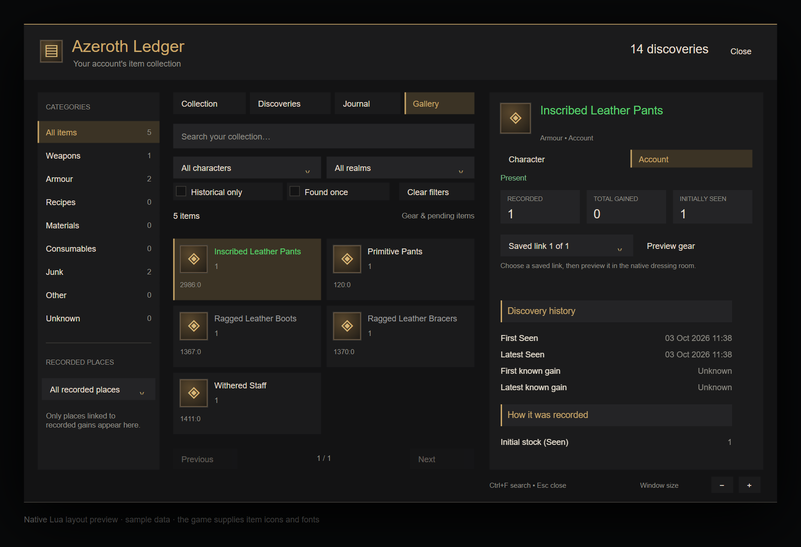

# Issue #26: Gear gallery and native previews

Revision 0.10.0 adds a Gallery tab to the Ledger book. Six native cards per page show saved weapon and armour variants; unclassified items remain visible while item data is pending. Gear classification uses numeric item classes, including poor-quality gear. The existing search, category, recorded-place, ownership, character and realm filters apply to the gallery. Selecting a card keeps the normal Collection details and lifetime facts visible. Clear filters keeps the current view.

The saved-link selector exposes every exact link retained for the selected variant, including enchants and gems. Changing variants resets the selector to the first saved link. Keyboard navigation uses the book's Tab/Shift+Tab, Enter, Up/Down, PageUp/PageDown and Escape controls; the existing scale controls fit the gallery to the screen. An empty or newly filtered gallery cannot keep a preview of an item outside the results. Queries, selection and preview never write SavedVariables.

The local `wow-ui-source` reference and installed Forever `BlizzardInterfaceCode` export both define `DressUpItemLink` in `Blizzard_UIPanels_Game/Mainline/DressUpFrames.lua`. The function checks `C_Item.IsDressableItemByID(link)` before opening the native model. The client adapter checks loaded item data and dressability using the exact saved link, then calls the native action under `pcall`. Missing APIs, unreadable data, non-wearable items and a rejected/throwing native preview produce visible fallback text with the saved item links available in the details. An item-data event refreshes the status without automatically opening the dressing room.

## Automated evidence

- Red/green Collection query case: the gallery originally included material stock (`2 ~= 3`); it now keeps gear variants and pending identities while respecting character and realm scope without saving.
- Red/green preview case: the missing preview adapter failed the genuine WoWUnit test definition in host replay; the adapter now preserves exact links and returns safe results for unloaded, non-wearable, missing and throwing native APIs.
- Red/green native frame replay: Gallery was originally absent. The replay now covers gallery cards, exact-link selection, keyboard variant selection, scoped filtering, empty/loading states, failed native previews and scaling without ledger writes.
- These cases live in `AzerothLedgerCollection`, `tests/book_query_spec.lua` and `tests/gallery_ui_spec.lua`. Host replay is distinct from genuine in-client WoWUnit execution and model rendering.
- All 16 Lua specs pass locally in separate Lua 5.1 processes. Lua 5.1 syntax, StyLua 2.5.2, LuaLS 3.19.1, package/load order and all three Python installer tests pass. The gallery page-size regression covers six-card pages, next/previous navigation and PageUp/PageDown. Pinned Luacheck runs in the PR's `verify` job.

This image renders the native frame layout through the test port. The game supplies the real fonts, icons and dressing-room model.

## In-client results

Native client control is unavailable in this environment. Current build, interface, locale, genuine WoWUnit result and Lua-error result are **unrun**. The inspected UI export establishes the adapter API, not live rendering.

| Check | Result |
| --- | --- |
| Genuine `AzerothLedgerCollection` WoWUnit group | Unrun |
| Wearable exact-link preview, including a built-in variant and an enchanted/gemmed link | Unrun |
| Non-wearable gear fallback, with the saved item link available | Unrun |
| Delayed or failed item-data load followed by refresh and explicit preview | Unrun |
| Gallery navigation, keyboard, scale and native model visibility together | Unrun |
| Lua errors during these interactions | Unrun |

Reload Forever, record `/al status` build/interface/locale/revision, run `AzerothLedgerCollection`, and fill the checks above with passed or failed results and any Lua errors. Open `/al`, choose Gallery, test character/realm filters and two intrinsic variants, select each retained full link and choose Preview gear. Confirm the native model is visible with the Ledger open. Test non-wearable and delayed-data cases before marking native validation complete.
